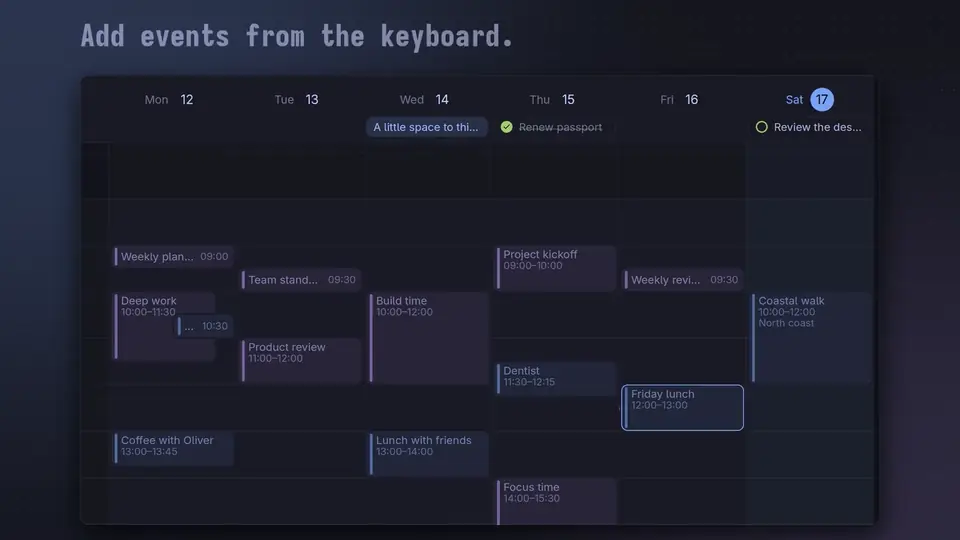

# Ocal

A calendar app for Omarchy. It syncs your Google calendars and keeps local calendars and tasks on your machine. Ocal is a native Rust app built with GPUI, and it follows your Omarchy theme.

[](https://kierangraham.com/media/promo/ocal.mp4)

[Watch the film (29 s, with sound)](https://kierangraham.com/media/promo/ocal.mp4)

**Ocal 0.1.0 is an early release.** [The feature list](docs/features.md) shows what works and what is still missing.

## Install

Ocal builds from source with `make install`. It needs Rust 1.97 or newer.

1. Install the build tools and libraries:

   ```sh
   sudo pacman -S --needed rustup base-devel clang pkgconf dbus openssl \
     libxcb libxkbcommon libxkbcommon-x11 wayland vulkan-icd-loader
   ```

   If you already use Arch's `rust` package, leave out `rustup` and skip step 2.

2. Install the Rust version the repository pins:

   ```sh
   rustup toolchain install 1.97.0
   ```

3. Build and install Ocal:

   ```sh
   git clone https://github.com/kierangraham/ocal
   cd ocal
   make install
   ```

4. Open **Ocal** from the app launcher, or run `ocal`.

`make install` puts three files under `~/.local`:

| File | Path |
| --- | --- |
| Binary | `~/.local/bin/ocal` |
| Desktop entry | `~/.local/share/applications/ocal.desktop` |
| Icon | `~/.local/share/icons/hicolor/scalable/apps/ocal.svg` |

**Set `PREFIX` to install somewhere else**, for example `make install PREFIX=/usr/local`. `DESTDIR` stages the files for packaging.

### Arch package

`packaging/arch/PKGBUILD` builds the `v0.1.0` release and installs Ocal under `/usr`:

```sh
cd packaging/arch
makepkg -si
```

**The package has no Google client built in.** To connect Google, pick your client file in the app. See [Configuration](#configuration).

## Update

From your clone:

```sh
git pull
make install
```

## Uninstall

```sh
make uninstall
```

Use the same `PREFIX` you installed with. Uninstalling leaves your data in place.

To remove your data as well:

```sh
rm -r ~/.local/share/ocal
secret-tool clear service ocal.google
```

The first command deletes local calendars and the Google cache. The second removes Ocal's Google tokens from the keyring.

## Usage


The window has a sidebar and the calendar. The sidebar shows a mini calendar, the current event, what's next, and your calendars.

**Views.** Day, week, month, agenda and tasks. Narrow windows show three days, and the sidebar can collapse.

**Add an event** in any of these ways:

- Press **C** or **Ctrl+N**.
- Double-click an empty slot.
- Shift-drag across empty time.
- Move the time cursor with the arrow keys. Hold **Shift** to extend a range, then press **Enter**.

The composer asks for a title, date and times first. **More details** adds guests, notes, repetition and time zone. **Ctrl+Enter** saves.

**Open an event** by clicking it, or by moving the cursor onto it and pressing **Enter**. Its details open beside it. **Enter** again edits it. **Delete** removes it, with **Undo**.

**Meeting links.** Paste a Meet, Zoom, Teams or other link. On a Google calendar that supports Meet, choose **Generate Google Meet**. **Join** appears once Google creates the meeting.

**Google sync** runs at startup, every five minutes, on **Ctrl+R**, and when you move into another month. It covers 60 days before and 120 days after the period on screen. Cached events stay readable offline.

**iCalendar import and export** are in the toolbar's **…** menu. Imports go into the local Personal calendar.

### Keys

| Key | Action |
| --- | --- |
| Arrows | Move the time cursor |
| Shift+arrows | Extend a new-event range |
| Enter | Open the highlighted event, or add at the cursor |
| C or Ctrl+N | New event |
| T | Today |
| 1 to 5 | Day, week, month, agenda, tasks |
| [ and ] | Previous and next period |
| / or Ctrl+F | Search cached events |
| Ctrl+Enter | Save the event |
| Escape | Close or go back |
| Ctrl+R | Sync |
| B | Show or hide the sidebar |
| Ctrl+plus, Ctrl+minus, Ctrl+0 | Zoom in, out, reset |
| ? | Shortcuts card |


## Demo mode

```sh
ocal --demo
```

**Demo mode uses an in-memory sample calendar.** It never connects to Google and never touches your data. Changes last until you close the window. The launcher entry's **Explore Sample Calendar** action does the same.

## Configuration

### Command-line options

| Option | Effect |
| --- | --- |
| `--demo` | Open the sample calendar |
| `--view day\|week\|month\|agenda\|tasks` | Open in that view |
| `--new` | Start a new event at the next quarter hour |
| `--version` | Print the version |

### Theme

**Ocal follows your Omarchy theme.** The sun and moon button in the sidebar footer, or Settings, overrides it with light or dark.

### Data

| What | Where |
| --- | --- |
| Local calendars and the Google cache | `~/.local/share/ocal/calendar.sqlite3`. `XDG_DATA_HOME` moves it. |
| Google tokens | The Secret Service keyring, under the service name `ocal.google` |

**Close Ocal before you back up the database.**

### Google Calendar

**Ocal ships no Google OAuth client.** You create a free one in your own Google Cloud project. Without it, local calendars still work, and Settings says Google sign-in is unavailable.

You also need an unlocked Secret Service keyring. Omarchy's GNOME Keyring works.

**Create the client:**

1. In the [Google Cloud console](https://console.cloud.google.com/), create a project.
2. Enable the **Google Calendar API**.
3. Open **Google Auth Platform**. Set the app name and audience. For an **External** audience, add your Google accounts as **test users**.
4. Under **Data access**, add these scopes:
   - `https://www.googleapis.com/auth/calendar.events`
   - `https://www.googleapis.com/auth/calendar.calendarlist.readonly`
5. Under **Clients**, create an OAuth client of type **Desktop app**.
6. Download its JSON file. It holds the client ID and secret.

**Test sign-ins last seven days.** While an External app is in **Testing**, Google expires its sign-ins after a week, so you reconnect. Publishing the app lifts the limit. Google then warns that the app is unverified each time you sign in.

**Give Ocal the client in one of two ways:**

- **Pick the file in the app.** In **Settings**, expand **Advanced connection options** and choose **Use a custom client file…**. This works with any build, including the Arch package.
- **Build it in.** Create `.cargo/config.toml` in your clone. The values below are placeholders; copy yours from the JSON file:

  ```toml
  [env]
  OCAL_GOOGLE_CLIENT_ID = "1234567890-abc.apps.googleusercontent.com"
  OCAL_GOOGLE_CLIENT_SECRET = "GOCSPX-..."
  ```

  Then run `make install` again. Later builds keep the values. Git ignores this file and `client_secret*.json`.

**Sign in:**

1. In **Settings**, choose **Copy Google sign-in link**.
2. Paste the link into the browser profile you want, pick an account and approve.
3. Keep Ocal open until it connects. The link works for ten minutes.

Choose **Add Google account** for more accounts. Each account keeps its own calendars, cache and tokens. Sign-in uses PKCE and a redirect to `127.0.0.1`, so no server sits between you and Google.

## Known issues

- **Clicking a task's checkbox also opens its details card.**
- **The toolbar overflows** when the window is between about 640 and 760 px wide.
- **After a save, the selection outline stays** until you press Escape a second time.
- **Google edits need a connection.** Ocal doesn't queue them offline. The composer stays open so you can retry.
- **Reminders don't notify.** Ocal keeps reminder settings but sends no notifications.
- **Import rejects complex repeat rules,** such as rules with exceptions, rather than dropping them.
- **Export is basic.** It leaves out guests, alarms and Google-only fields.

## Development

```sh
make demo     # run the sample calendar from source
make run      # run with your data
make check    # cargo check, all targets
make test     # all tests
make lint     # rustfmt check, then clippy with warnings as errors
make clean    # remove build output
```

| Crate | Contents |
| --- | --- |
| `ocal-core` | Models, recurrence, layout, SQLite storage, OAuth, Google Calendar and iCalendar |
| `ocal-app` | GPUI views, plus a background worker so network calls never block drawing |

Debug builds leave out debug symbols to save disk space. Set `CARGO_PROFILE_DEV_DEBUG=limited` when you need a debugger. [docs/testing.md](docs/testing.md) explains what the tests cover.

## Licence

MIT. See [LICENSE](LICENSE). [CHANGELOG.md](CHANGELOG.md) lists changes by release.

---

[kierangraham.com](https://kierangraham.com)
