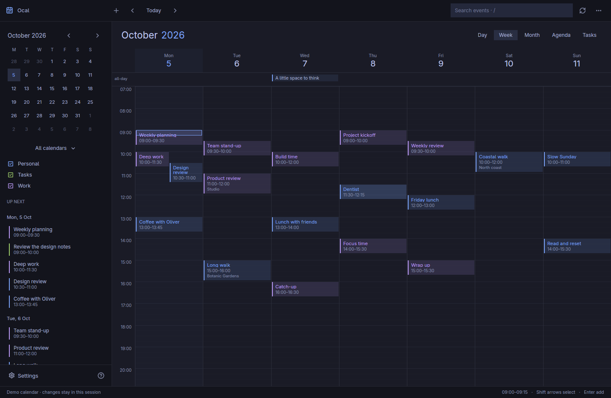

# Ocal

A native calendar for Omarchy, built with Rust, GPUI Kit and GPUI Omarchy: the same stack as Disktree and Omail. Google Calendar first, with local calendars that work immediately.

This is an early working build. The reference is Fantastical's clean calendar, sidebar agenda and compact event editor; [the feature matrix](docs/features.md) separates implemented behavior from remaining work. There is no natural-language entry.

## Try it

```sh
make install
ocal --demo
```

`--demo` uses an in-memory sample calendar and never connects to Google. Run `ocal` for your persistent calendar. Installation adds an application launcher entry, executable and icon under `~/.local`. `PREFIX` and `TARGET_DIR` can be overridden.

`make clean` removes generated build artifacts. If using Omail's shared build directory, use `make clean TARGET_DIR=../omail/target`. Installed apps and calendar data remain available; the next build recompiles dependencies. Development builds disable debug symbols and incremental compilation to limit disk usage. For debugging, enable symbols with `CARGO_PROFILE_DEV_DEBUG=limited`.

Rust 1.97.0 is pinned. Arch needs a C/C++ compiler, CMake, pkg-config, OpenSSL, D-Bus, Fontconfig, Wayland, xkbcommon, Vulkan and ALSA development libraries. GPUI needs a graphics driver; native file dialogs use the desktop portal. Google credentials use an unlocked Secret Service keyring.



## Add events quickly

- Arrows move a thin time cursor between days and in 15-minute steps. Crossing an event highlights it; **Enter** opens its details. Hold **Shift** to extend a new-event range by 15 minutes per step, even through existing events; **Enter** opens the editor for that range. **C** always creates a new event.
- Timed events match their actual duration, including short appointments and overnight continuations. Short events use a compact title; longer events show their time and location as space allows.
- **Shift-drag** across empty calendar space selects a range in 15-minute increments and opens the editor on release. Drag in either direction or across days.
- Double-click an empty slot, right-click for a context menu, use **Add**, or press **C / Ctrl+N**. All routes open the same explicit form.
- Fill the title, calendar, start/end dates and times. Location and a meeting choice stay readily accessible. Expand **More details** for guests, notes, repetition and time zone. **Ctrl+Enter** saves; **Escape** closes, with a discard check for changes.
- Choose **Paste a meeting link** for an existing Meet, Zoom, Teams or other HTTP(S) link. Choose **Generate Google Meet** for a Google calendar that advertises Meet support. Ocal requests the conference on save, displays a pending state if Google is still generating it, and offers **Join meeting** once available. Ocal automatically checks the new conference for up to a minute; manual sync can also refresh it. Retry uses the same request ID. Choosing **No meeting link** removes an existing Google conference explicitly.
- Guest invitations are a separate explicit choice. Remote events show **Save & invite** when guests and notification are enabled.

Day, week, month, agenda and local tasks views share a mini calendar and calendar sets. Small windows use one day with a compact view picker and an optional sidebar. Scrolling forms keep the save button visible. Theme colors and typography follow Omarchy; icons, context menus and focus behavior match Omail.

## Keyboard

| Key | Action |
| --- | --- |
| Arrows / Shift+arrows | Move the time cursor / extend a new-event range |
| Enter | Open the highlighted event, or add at the cursor / range |
| C / Ctrl+N | New event |
| T | Today |
| 1 / 2 / 3 / 4 / 5 | Day / week / month / agenda / tasks |
| [ / ] | Previous / next period |
| / / Ctrl+F | Search cached events |
| Menu / Shift+F10 | Context menu for the current selection |
| Ctrl+Enter | Save event |
| Escape | Dismiss or return to the calendar |
| Ctrl+R | Sync |
| B | Toggle compact sidebar |
| Ctrl+plus / minus / 0 | Zoom in / out / reset |
| ? | Keyboard help |

Navigation shortcuts do not consume text typed into the editor or search field. Context menus handle their own arrows, Enter and Escape.

## Connect Google Calendar

In a publisher-configured build, open settings and choose **Copy Google sign-in link**. Ocal copies the original authorization URL without opening a browser. Paste it into your preferred browser profile, pick your account and approve access; keep Ocal open until the connection finishes. No Cloud project, JSON file or password entry in Ocal is required from users. OAuth uses PKCE, state verification and a loopback callback; tokens go into Secret Service, not the calendar database. Sign-in progress and errors appear beside the account button; a completed connection returns to the calendar. Google authorization and initial calendar sync are separate stages.

Connect any number of Google accounts. After the first, choose **Add Google account** in Settings; the sidebar also provides a shortcut. Each account’s sign-in link leads to Google’s account chooser. **Copy again** retains the same active attempt; links remain active for ten minutes. **Cancel** releases the attempt so a fresh link can be generated. **Open default browser** is an explicit optional action. Copy the link from Ocal rather than copying an intermediate Google login page or the final localhost callback. Calendars are grouped under their account email, and the event editor includes the account email in calendar choices. Credentials, cached events and visibility stay separate even when two accounts subscribe to the same shared calendar. Reconnecting an existing account updates it without adding a duplicate. A failed account sync leaves its cache intact and lets other accounts update; adding an account syncs that account independently.

The source checkout does not ship a public publisher client. Unconfigured builds disable normal sign-in with an explanation; configured builds enable it. Local calendars remain usable in either case. **Advanced connection options → Use a custom client file…** retains the developer-only JSON route.

Requested scopes are `calendar.events` and `calendar.calendarlist.readonly`. Ocal imports calendar names, colors, time zones, access and Meet capability. It uses paginated Calendar API calls, server-expanded recurring instances and ETags for writes. Google account policy may disable Meet. See [Google's event creation guide](https://developers.google.com/workspace/calendar/api/guides/create-events).

Sync covers 60 days before and 120 days after the current navigation period and runs at startup, every five minutes, manually and when navigating into another month. The cache supports offline reading; Google writes require a connection and errors retain the editor for retry. Pending writes are not queued offline. Sync replaces a calendar's cached range only after its complete fetch succeeds.

Local data lives at `$XDG_DATA_HOME/ocal/calendar.sqlite3`, normally `~/.local/share/ocal/calendar.sqlite3`. Demo never touches it. Back up the database with Ocal closed. Calendar sets and visibility persist; view, zoom and display-zone choices currently reset on launch.

## iCalendar

Import/export are in the toolbar menu. Imports go into local Personal, validate the whole file before writing and deduplicate by UID. Basic events, date-only ranges, tasks and simple daily/weekly/monthly/yearly recurrence are supported. Complex rules and exceptions produce an error rather than silently losing their schedule. Export is a basic interchange format, not a complete account backup; attendees, alarms and advanced Google fields are not round-tripped.

## Development

```sh
make check
make test
make lint
make demo
```

### Publisher Google sign-in configuration

Google requires one registered Desktop OAuth client for the application. This is publisher setup, not an end-user task; Ocal does not need a hosted authentication server.

1. In the publisher’s Google Cloud project, enable **Google Calendar API**.
2. Configure the Google Auth Platform app identity, audience and requested scopes. Add test users while testing; complete applicable verification before public distribution.
3. Create a **Desktop app** OAuth client for Ocal.
4. Set `OCAL_GOOGLE_CLIENT_ID` and, if supplied by Google, `OCAL_GOOGLE_CLIENT_SECRET` in the build environment, then run `make install`. Cargo embeds this application metadata in the binary. Users do not set these variables. Empty or invalid IDs leave ordinary sign-in unavailable. For local development, these build variables can be kept in Cargo’s `[env]` table in `.cargo/config.toml`, which is ignored by Git; then ordinary `make install` rebuilds retain the configuration.

Google considers installed applications public clients: bundled client metadata is not a private credential. Account access/refresh tokens and PKCE verifiers are never compiled into the app. Existing accounts retain their original client configuration in the keyring so refresh continues after changing a build's publisher client. A downloaded Desktop client JSON can also be selected through the advanced connection options during development.

See [Google’s native app OAuth requirements](https://developers.google.com/identity/protocols/oauth2/native-app) and [verification guidance](https://developers.google.com/identity/protocols/oauth2/production-readiness/sensitive-scope-verification). Configuring a client does not replace live-account verification.

`ocal-core` contains models, selection, recurrence, overlap layout, SQLite, OAuth, Google API, service and iCalendar logic. `ocal-app` contains native views and a background worker so network calls and dialogs do not block drawing.

See [validation](docs/validation.md) for checks and live-account limitations. MIT licensed. Fantastical, Disktree and Omail are implementation/design references; no proprietary artwork is included.
