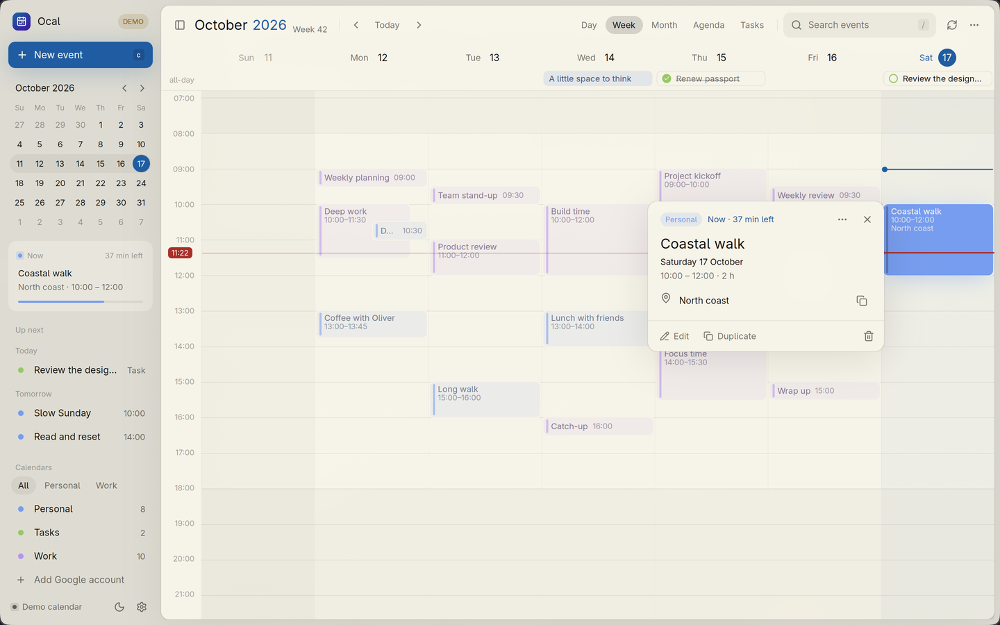

# Ocal

A native calendar app for Omarchy, built in Rust with GPUI. It syncs Google Calendar and keeps local calendars and tasks on your machine.

This is an early build. [The feature list](docs/features.md) shows what works and what is still missing.


## Requirements

- **Omarchy** on Arch Linux.
- **Rust 1.97.0.** `rust-toolchain.toml` pins it, and rustup installs it on the first build.
- **Build tools and libraries:**

  ```sh
  sudo pacman -S --needed rustup base-devel clang cmake pkgconf openssl dbus \
    fontconfig wayland libxkbcommon vulkan-icd-loader alsa-lib
  ```

- **A Secret Service keyring** for Google sign-in. Omarchy's GNOME Keyring works. Unlock it before you connect an account.
- **Your own Google OAuth client** to use Google Calendar. See [Connect Google Calendar](#connect-google-calendar). Local calendars work without one.

## Install

```sh
git clone https://github.com/kierangraham/ocal
cd ocal
make install
```

`make install` builds a release binary and installs these files under `~/.local`:

- `bin/ocal`
- `share/applications/ocal.desktop`
- `share/icons/hicolor/scalable/apps/ocal.svg`

Set `PREFIX` to install somewhere else. `make uninstall` removes the same three files. Your calendar data stays.

To update, pull and run `make install` again.

## Connect Google Calendar

**This repository ships no Google OAuth client.** Each user registers a free Desktop app client in their own Google Cloud project. Without one, Settings explains that sign-in is unavailable, and local calendars still work.

### Create the client

1. In the [Google Cloud console](https://console.cloud.google.com/), create a project.
2. Enable the **Google Calendar API** for it.
3. Open **Google Auth Platform** and set up the app name and audience. For an **External** audience, add your own Google accounts as **test users**.
4. Under **Data access**, add these two scopes:
   - `https://www.googleapis.com/auth/calendar.events`
   - `https://www.googleapis.com/auth/calendar.calendarlist.readonly`
5. Under **Clients**, create an OAuth client of type **Desktop app**.
6. Download its JSON file. It holds the client ID and client secret.

**Keep the JSON file out of Git.** `.gitignore` already ignores `client_secret*.json` and `.cargo/config.toml`.

**Test-mode sign-ins expire after seven days.** While an External app stays in **Testing**, Google expires its refresh tokens after a week, and you reconnect. Publishing the app removes that limit. Google then shows an "unverified app" warning on sign-in until the app passes verification.

### Give Ocal the client

Choose one of these two options.

**Option 1: build the client into Ocal.** Create `.cargo/config.toml` in the checkout. Copy the values from the JSON file:

```toml
[env]
OCAL_GOOGLE_CLIENT_ID = "1234567890-abc.apps.googleusercontent.com"
OCAL_GOOGLE_CLIENT_SECRET = "GOCSPX-..."
```

The values above are placeholders. Then run `make install` again. Cargo compiles the values into the binary, and every later `make install` keeps them.

**Option 2: pick the file in the app.** Open **Settings**, expand **Advanced connection options** and choose **Use a custom client file…**. Select the downloaded JSON file. This needs no rebuild.

### Sign in

1. In **Settings**, choose **Copy Google sign-in link**. Ocal copies the link and does not open a browser.
2. Paste the link into the browser profile you want. Pick an account and approve access.
3. Keep Ocal open until the connection finishes. The link stays active for ten minutes.

To add another account, choose **Add Google account**. Ocal groups calendars under each account's email address.

**How Ocal handles the sign-in:**

- **OAuth uses PKCE and a loopback redirect** to `127.0.0.1`. No hosted server is involved.
- **Tokens go into the Secret Service keyring**, not the calendar database.
- **Each account keeps the client it signed in with.** Changing the client later does not break existing accounts.

## Usage

Run `ocal`, or open **Ocal** from the app launcher.



**Views.** Day, week, month, agenda and tasks share a sidebar with a mini calendar, upcoming events and calendar sets. Narrow windows show fewer days, and the sidebar can collapse.

**Adding events.** Any of these opens the event composer:

- Press **C** or **Ctrl+N**.
- Double-click an empty slot.
- Shift-drag across empty time to select a range.
- Move the time cursor with the arrow keys. Hold **Shift** to extend a range, then press **Enter**.

The composer takes a title, date and times first. **More details** adds guests, notes, repetition and time zone. **Ctrl+Enter** saves.

**Meeting links.** Paste a Meet, Zoom, Teams or other link. On a Google calendar that supports Meet, choose **Generate Google Meet**. Ocal shows **Join** once Google creates the meeting.

**Google sync** runs at startup, every five minutes, on **Ctrl+R**, and when you move into another month. It covers 60 days before and 120 days after the period on screen. Cached events stay readable offline.

**iCalendar import and export** are in the toolbar's **…** menu. Imports go into the local Personal calendar.

### Keyboard

| Key | Action |
| --- | --- |
| Arrows | Move the time cursor |
| Shift+arrows | Extend a new-event range |
| Enter | Open the highlighted event, or add at the cursor |
| C / Ctrl+N | New event |
| T | Today |
| 1 to 5 | Day, week, month, agenda, tasks |
| [ / ] | Previous / next period |
| / or Ctrl+F | Search cached events |
| Ctrl+Enter | Save event |
| Escape | Close or go back |
| Ctrl+R | Sync |
| B | Toggle the sidebar |
| Ctrl+plus / minus / 0 | Zoom in / out / reset |
| ? | Shortcuts card |

### Your data

**Local calendars and the Google cache live in one SQLite file:** `~/.local/share/ocal/calendar.sqlite3`. Ocal follows `XDG_DATA_HOME` if you set it. Close Ocal before you back it up.

## Demo mode

```sh
ocal --demo
```

**Demo mode uses an in-memory sample calendar.** It never connects to Google and never touches your database. Changes last until you close the window. The app launcher entry has an **Explore Sample Calendar** action that does the same.

## Known issues

These bugs are open:

- **Clicking a task's checkbox also opens its details card.**
- **The toolbar overflows** when the window is between about 640 and 760 px wide.
- **After a save, the selection outline stays** until you press Escape a second time.

These features are not built yet:

- **Offline Google edits.** Ocal does not queue them. Saving needs a connection, and the composer stays open to retry.
- **Reminders.** Ocal keeps reminder settings but sends no notifications.
- **Moving or resizing events by dragging.**
- **Removing an account** from the app.
- **Complex repeat rules.** Import rejects rules with exceptions rather than dropping them.
- **Full export.** iCalendar export leaves out guests, alarms and Google-only fields.

## Development

```sh
make demo     # run the sample calendar from source
make run      # run with your real data
make check    # cargo check, all targets
make test     # cargo test
make lint     # rustfmt check and clippy with warnings as errors
make clean    # remove build output
```

The workspace has two crates:

- **`ocal-core`** holds the models, recurrence, layout, SQLite store, OAuth, Google API and iCalendar code.
- **`ocal-app`** holds the GPUI views and a background worker, so network calls never block drawing.

Debug builds skip debug symbols to save disk. Set `CARGO_PROFILE_DEV_DEBUG=limited` when you need a debugger. [docs/validation.md](docs/validation.md) lists what the tests cover.

## Licence

MIT. See [LICENSE](LICENSE).

---

[kierangraham.com](https://kierangraham.com)
