# Ocal redesign: gap analysis

This compares the HTML prototype (`docs/prototype/redesign.html`, open it in a browser) with the app as it is in the source today. It lists what the app needs to gain to match the prototype, and what the prototype leaves out that the app already does.

**Status (17 October 2026):** implemented. The checklists below record the plan; the app now matches the prototype's layout, surfaces and behaviour, with these deliberate differences:

- Controls drawn by gpui-omarchy stay stock rather than being restyled to match the mock-up: text inputs keep their fill (the composer title and search field), the date picker is its outlined button, and All day is the standard switch.
- Search keeps its results list rather than filtering the view in place.
- Everything marked **keep** below stays: the time cursor, Shift ranges, context menus, RSVP and the guest list, the full editor fields, account groups and narrow layouts.

Screenshots of the finished app are in [`docs/validation.md`](../../validation.md).

The prototype follows Omail's redesign prototype (`docs/prototype/redesign.html` in the Omail repository): the same colour tokens, inset sidebar, raised sheet, pill tabs, icon buttons, tooltips, toast and floating "reply box" cards. Where this doc says "like Omail", it means that prototype.

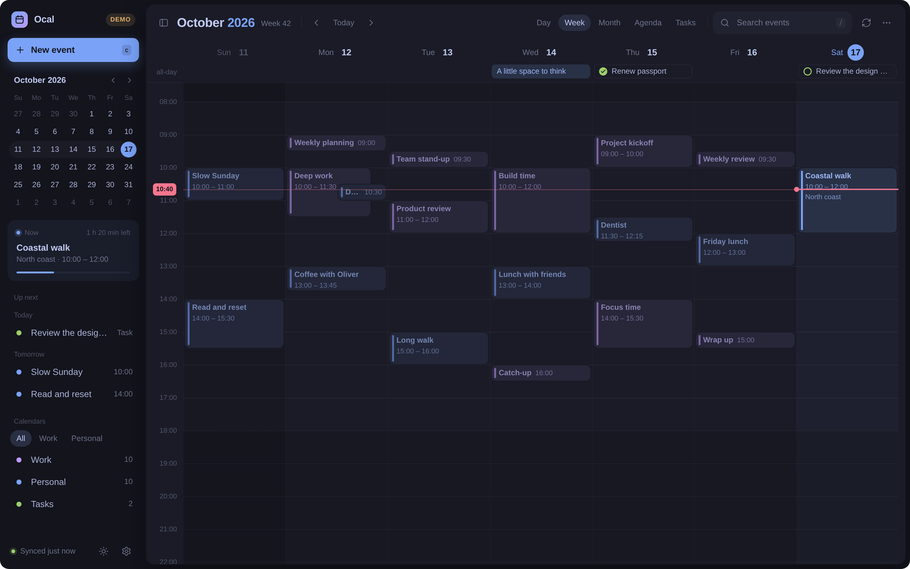

## What the prototype changes overall

- **Layout.** The window is split into a sidebar that sits directly on the inset background and a raised, rounded "sheet" for the calendar. The full-width header and the status bar are gone. Branding and **New event** move into the sidebar, and the toolbar moves inside the sheet.
- **Visual language.** Soft fills replace hairline borders. Corners are rounded (5–14 px), floating surfaces have shadows, and calendar colours are mixed into fills and text. Gpui-omarchy deliberately avoids all three: its theme sets every radius token to zero (`gpui-omarchy/src/theme.rs:149-156`), and its popover and toast surfaces call `rounded_none()`.
- **Floating surfaces instead of docked panels.** Event details become a popover anchored to the event. The editor becomes a centred composer card, keyboard help becomes a small card, and confirmations become toasts.
- **Tasks show up everywhere.** Tasks appear with checkboxes in the all-day row, the month grid, the agenda and Up next, not only in the Tasks view.
- **New sidebar content.** The sidebar gains a "Now" card with a progress bar, a shorter Up next grouped by day, and calendar sets as pill tabs.
- **Less keyboard and power-user surface.** The prototype has no time cursor, range selection, context menus, status bar or narrow layouts. These are flagged below as keep / move / decide.

## How to read this

- Each section has a prototype crop, then **Today** (what the app does, with `file:line`), **Prototype** (what changes) and **To implement** (a checklist).
- Paths are relative to `crates/ocal-app/src/` unless they start with `ocal-core/` or `gpui-omarchy/` (`~/.cargo/registry/.../gpui-omarchy-0.1.3/src`).
- Each checklist item is tagged by kind: **visual** (styling only), **behaviour** (new interaction or state in the app) or **core** (new data or `ocal-core` support). Size is **S** (under half a day), **M** (a day or two) or **L** (several days, or a design decision first).
- Capture details: headless Chromium, 1440×900 at 2× with `--force-prefers-reduced-motion`, "today" fixed at Sat 17 Oct 2026, 10:40. States come from the prototype's URL hooks: `#day|week|month|agenda|tasks`, `?select=<title>`, `?compose=1`, `?light=1`, `?collapsed=1`, `?keys=1`, `?q=`, `?hide=`, `?set=`, `?toast=`.
- "Rounded" below means passing explicit radii (`rounded(px(n))` / `rounded_full()`). The app already does this for small dots (`ui/sidebar.rs:70`, `ui/grid.rs:263`), so it works despite the zero theme tokens. It does mean overriding gpui-omarchy components (buttons, inputs, popovers) by hand.

---

## 1. Window shell and visual language

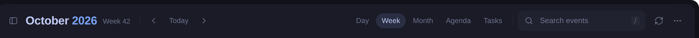

**Today**
- One flat column: header (`HEADER` 2.7 rem, `inset` fill, bottom divider) `ui/chrome.rs:134-142`, then body with sidebar + content `ui/mod.rs:868-873`, then status bar `ui/chrome.rs:345-402`.
- Sidebar and header share `t.inset`; the content uses `t.background`. Separation is by 1 px `divider()` borders throughout.
- Square corners everywhere, apart from the dots noted above. Panels use `shadow_lg()` (`ui/details.rs:426`, `ui/editor.rs:1032`).
- Colour helpers: `tint()` blends a calendar colour over the background (`appearance.rs:86-88`). `event_text()` swaps to `bright` on light themes (`appearance.rs:90-96`).

**Prototype**
- The sidebar has no border and sits on `inset`. The main sheet is `background`, inset 8 px from the window edge, with 12 px radius and a faint ring and shadow (Omail's `--sheet-shadow`).
- Dividers are much fainter (`foreground` at 7% against the app's 12%). Grouping comes from fills (`foreground` at 5% for hover and quiet fills, `selection` for active items).
- Extra text greys, as in Omail: `muted` is `foreground` at 58% and `faint` at 38%. Both derive from the theme, but neither is a `gpui_omarchy::Theme` field (`gpui-omarchy/theme.rs:10-29`). Floating cards use `background` with a ring and shadow.
- Text colour for events is `color-mix(calendar 50%, bright)`, not the raw calendar colour.
- The 14 px outer rounding of the mock-up window is Omail's prototype frame, not something the app draws.

**To implement**
- [ ] Shared style constants: radii (sm 5–7, md 8–10, lg 12–14), two shadow presets (sheet, floating card) and fill levels (fill, hover) in `appearance.rs`. — visual, S. GPUI supports explicit radii and `BoxShadow`; gpui-omarchy tokens stay at zero, so every themed component that should look rounded has to be overridden in the app.
- [ ] A `mix(a, b, amount)` colour helper beside `tint()`, plus derived `muted` and `faint` text colours (e.g. `secondary.opacity(..)` or `foreground.blend(background, ..)`). Don't hard-code Tokyo Night hex values. — visual, S.
- [ ] Body layout: sidebar on `inset` with no border, content inside a rounded `background` sheet with an 8 px margin. — visual, S.
- [ ] Remove the full-width header; move its contents into the sheet's toolbar (section 2) and the sidebar (section 3). — visual, M (also touches the overlay sidebar in narrow windows, `ui/mod.rs:1018-1029`).
- [ ] Remove or slim the status bar. **Decide**: see "What the prototype drops". — behaviour, M.
- [ ] Do not draw outer window rounding or shadow; Hyprland owns window decoration. — n/a.

## 2. Header / toolbar

**Today** (`ui/chrome.rs:55-221`)
- Brand ("Ocal" + icon) and the hide-sidebar button sit in the header above the sidebar column (`:69-97`).
- Prev / Today / Next are separate controls (`:156-183`). The title has the year in the accent colour (`:98-121`).
- The view switch is a bordered segmented control with an accent underline and tooltips "Week · 2" (`:224-294`). It becomes a menu below 640 px (`:226-253`).
- Search is a text input that is always open from 1100 px and otherwise an icon that expands (`:122-132`, `:194-204`). Its placeholder is "Search events · /" (`ui/mod.rs:236`).
- Tool buttons for New event (`+`), Sync and the "…" menu (Settings, Import, Export, Keyboard shortcuts) `:205-219`, `:296-343`.

**Prototype**
- The toolbar starts with a **sidebar toggle** (`b`), as Omail's list header does. Collapsing slides the sidebar away and the sheet takes the full width (crop below).
- 20 px title with the year in accent, then the **ISO week** in muted text ("Week 42") in Week view, or "Today" in Day view, or "3 to do" in Tasks.
- A hairline separator, then prev and next as 30 px muted icon buttons around a **Today** pill. Today dims when the current period is already in view.
- View switch as Omail's **pill tabs**: no track, no underline; the active tab has a `selection` fill.
- Search is always a 220 × 36 px field with a magnifier and a `/` keycap, like Omail's; it gains an accent ring when focused.
- Sync and "…" only. New event and the brand moved to the sidebar.
- Every icon button has a tooltip in the "Label · key" format, drawn as a bright inverted label like Omail's.

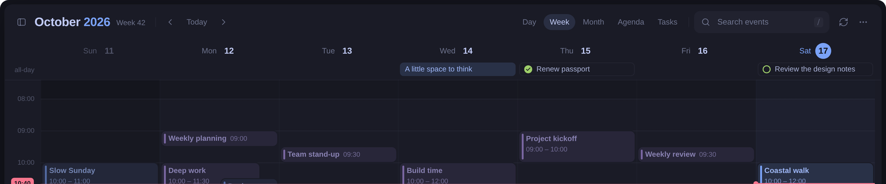

**To implement**
- [ ] Sidebar toggle at the start of the toolbar (replaces the header's hide button and the `toggle-sidebar` button). — behaviour, S.
- [ ] Title restyle (20 px ≈ 1.25 rem) and a muted sub-label per view. — visual, S.
- [ ] ISO week in Week view (`date.iso_week().week()`). — behaviour, S. Weeks start on Sunday (`ocal-core/model.rs` `week_start`), so the prototype takes the ISO week of the Monday inside the Sunday-start week. Keep that rule, or show it only when weeks start on Monday.
- [ ] Prev / Today / next as icon buttons and a pill; Today dimmed when the current period is in view. — visual, S.
- [ ] Pill tabs for the view switch, shared with calendar sets, the composer and the tasks filter. — visual, S (custom radius; built from `button` as today).
- [ ] Search field with leading icon and trailing `/` keycap (`gpui_omarchy::keycap`), focus ring in accent. — visual, S. Keep the existing collapse-to-icon behaviour below `WIDE`.
- [ ] Tooltip restyle to the bright inverted label (the "Label · key" text already exists, `appearance.rs:4-31`). — visual, S.
- [ ] Drop the header `+` button once the sidebar **New event** button exists. Keep a `+` in the toolbar when the sidebar is hidden or in narrow windows. — behaviour, S.

## 3. Sidebar

### 3a. Brand, New event, mini calendar

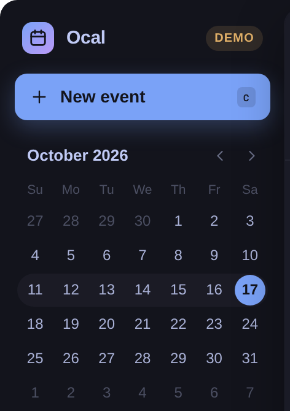

**Today** (`ui/sidebar.rs`)
- Mini month with square 1.75 rem day buttons (`:40-73`). Today has an accent fill; the selected day has a `selection` fill.
- The week in view is a `hover_fill` row band (`:21-28`). Busy days get a 3 px dot (`:13-20`, `:63-72`). Weekday initials start on Sunday (`:109`).
- No New event button in the sidebar; brand lives in the header (`ui/chrome.rs:69-97`).

**Prototype**
- Brand row as in Omail: a rounded tile with an accent-to-violet gradient, "Ocal", and a **DEMO** badge in `warning` when running `--demo`. The hide button moved to the toolbar.
- Full-width primary **New event** button (Omail's Compose: 38 px, accent glow) with a `c` keycap.
- Circular days. Today is filled, the selected day gets a 1.5 px accent ring, and the week in view is a band with rounded ends.
- No busy-day dots. They were dropped on purpose to reduce clutter: the demo has events every day, so every day had a dot.

**To implement**
- [ ] Brand row in the sidebar header (logo tile, name, DEMO badge). — visual, S. Omail uses the same gradient; `violet` isn't a `gpui_omarchy::Theme` field, so take it from the palette's magenta or use the app icon.
- [ ] Primary **New event** button with keycap. — visual, S (custom radius; the glow shadow is optional).
- [ ] Mini month restyle: circular day cells, ring for the selection, rounded week band. — visual, S.
- [ ] Busy-day dots: **decide**. They carry information on sparse calendars; with a full calendar they are noise. Possibly show them only for days outside the visible period.

### 3b. Now card and Up next

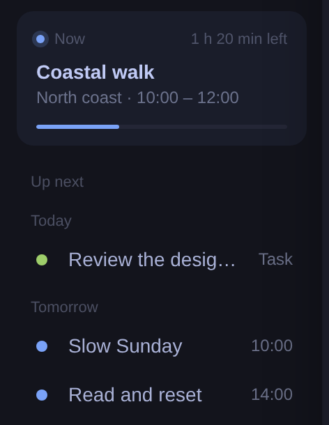

**Today**
- No "now" card. Details show "Now · 40 min left" for a running event (`ui/details.rs:5-27`). Up next marks a running event "Now · 10:00–11:00" in accent (`ui/sidebar.rs:262`, `:292-297`).
- Up next: up to 8 events from the next 7 days, timed and all-day only. Tasks are filtered out (`ui/sidebar.rs:242-247`), as are completed items (`ui/mod.rs:593`).
- Each row has a colour bar, title, and "Today · 10:00–11:00" (`:258-303`). The view redraws every 30 s (`ui/mod.rs:251-261`).

**Prototype**
- **Now card** for the event in progress, styled like Omail's open message (12 px radius, `surface` at 45%). A "Now" label with a dot in the calendar colour and "1 h 20 min left" on the right, then the title, "location · 10:00 – 12:00" and a thin progress bar. Clicking it opens details.
- **Up next** has a sentence-case label like all sidebar sections ("Up next", "Calendars"), and is grouped under day sub-headings ("Today", "Tomorrow", then "Mon 19 Oct"). It is capped at 3 items over 4 days, excludes the running event, and includes **tasks** ("Task") and all-day items. Rows are Omail's 34 px nav rows: a round colour dot, title and right-aligned start time.

**To implement**
- [ ] Now card: pick the current timed event (reuse `relative_time` logic), show progress and time left, click → `pick_event`. — behaviour, M. A 30 s tick is enough for minutes left. The prototype's dot is static (a soft ring, like Omail's sync dot), so no animation is needed.
- [ ] Choose what happens with overlapping current events (prototype takes the first by start time). — behaviour, S.
- [ ] Up next grouping by relative day with sub-headings; exclude the event shown in the Now card; cap the count. — behaviour, S.
- [ ] Include open tasks in Up next (label "Task"). — behaviour, S (filter change at `ui/sidebar.rs:245`).
- [ ] Row restyle: dot + title + right-aligned time. — visual, S.

### 3c. Calendars and sets

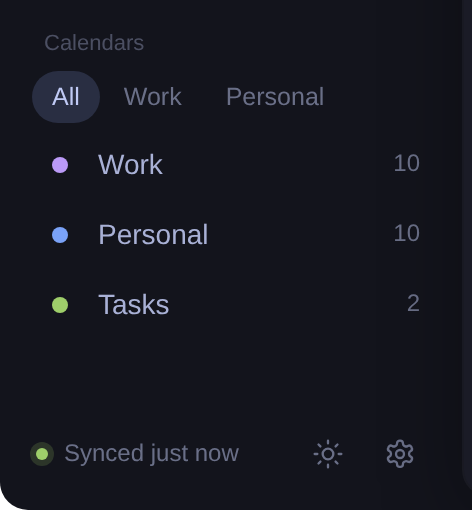
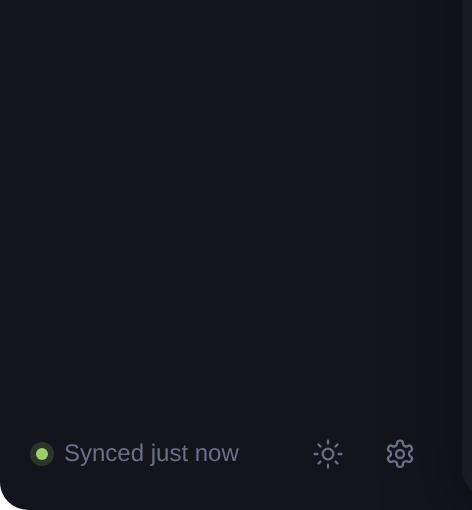
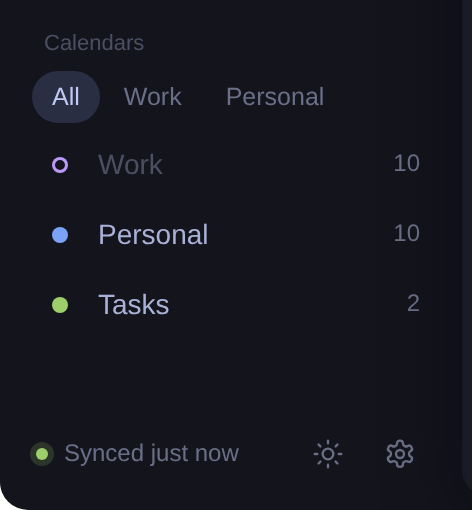

**Today**
- **Sets** are a separate "SETS" section of nav rows ("All calendars", then each set) `ui/sidebar.rs:124-156`, shown only if sets exist.
- **Calendars** are grouped by account ("On this computer", then each Google account email) `:157-224`. They use square swatches, filled when visible and outlined when hidden (`appearance.rs:165-172`), and a "read-only" label (`:201-206`).
- An "Add Google account" row opens Settings (`:225-233`).
- Toggling a calendar clears the active set (`:216-218`). Sets are created and deleted in Settings (`ui/settings.rs:287-386`).

**Prototype**
- Sets are pill tabs under the "Calendars" label ("All · Work · Personal"), like Omail's list filters. There is no separate section and no "All calendars" row; "All" is a tab.
- With a set active, the list shows **only that set's calendars** (second crop); the app shows every calendar.
- Calendar rows are Omail's label rows: round dot, name and a count (this week's events). Hidden calendars get a hollow dot and faint name (third crop).
- No account groups, no read-only label, no "Add Google account" row.

**To implement**
- [ ] Set tabs under the Calendars label, "All" first; selecting one sets `active_set`. — behaviour, S. **Decide** overflow: tabs don't fit more than about 3 short names in 232 px. Fall back to a select or wrap.
- [ ] Per-calendar count of events in the visible period. — behaviour, S. **Decide** whether a count is useful here; Omail's counts are unread mail, which is more actionable.
- [ ] Filter the calendar list to the active set's calendars. — behaviour, S. **Decide** how toggling a calendar outside the set works; today it clears the set (`ui/sidebar.rs:216`).
- [ ] Round dots instead of square swatches (filled / outlined). — visual, S.
- [ ] Keep account groups, the read-only label and "Add Google account". — **keep** (the prototype only models local calendars).

### 3d. Sidebar footer

**Today**: footer with a "Settings" text button and a help icon (`ui/sidebar.rs:330-366`). Sync and status messages go to the status bar (`ui/chrome.rs:372-381`).

**Prototype**: Omail's footer: a green dot with a soft ring and "Synced just now", then a light-mode toggle and a settings icon button. No help button; `?` opens the shortcuts card (section 12).

**To implement**
- [ ] Sync status line in the footer: dot colour for state (synced / syncing / error / offline) and short text. — behaviour + core, M. The app has only free-text `status` and `error` (`ui/mod.rs:193-194`). It needs a structured sync state from the worker (last sync time, in progress, last error per account).
- [ ] Icon-only Settings button. — visual, S.
- [ ] Light-mode toggle: **decide** (section 15). The app follows the Omarchy system theme; a toggle would be an override, and Omail's prototype has the same question.
- [ ] Discoverability of keyboard help without the footer help button: keep "Keyboard shortcuts" in the "…" menu (`ui/chrome.rs:296-343`). — S.

## 4. Week and day grid

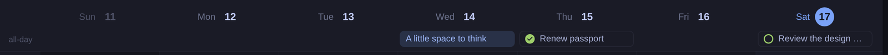
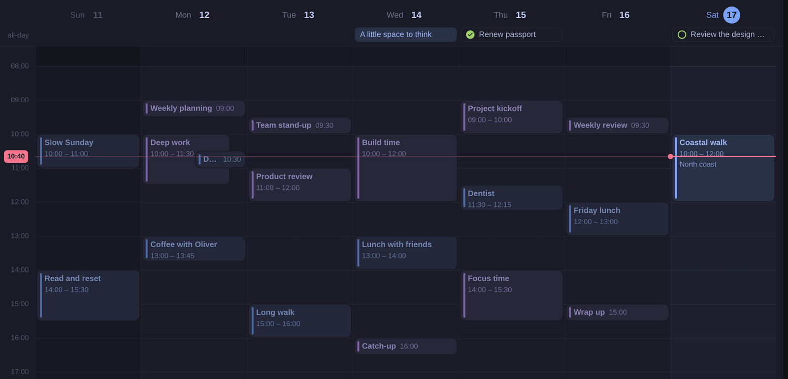

**Today** (`ui/grid.rs`)
- Day headings: weekday + `day_number` (a square accent badge for today) on one row. Weekend tint at 2%. The selected date gets a 2 px accent underline (`:31-79`). Clicking only selects the date (`:77`).
- All-day row always shown, labelled "ALL DAY", at most 2 items then "+N more" → Day view (`:80-138`). **Tasks are excluded** (`:102`).
- 24 h grid with hour and half-hour lines (`:184-198`). Hour labels are centred on the line, 00:00 is skipped and the label nearest "now" is hidden (`:149-164`).
- Now indicator in **accent**: a gutter pill (`:165-182`), a 2 px line on today's column and a 35% line on other days (`:464-486`).
- Today's column gets an accent 3.5% tint; weekends a foreground 2% tint (`:214-217`).
- Initial scroll to about 07:00, or to now if that is lower (`:577-600`).

**Prototype**
- Heading "Sat **17**" with a circular today badge; weekend headings in muted text. No selected-date underline. Clicking a heading opens **Day view** for that date.
- All-day row only shown when something is in it, labelled "all-day". All items shown, tasks included, with **round checkboxes** that toggle completion in place. Tasks are outlined pills; all-day events are filled pills.
- **Off-hours shading** before 08:00 and after 18:00.
- Hour lines only, fainter.
- Now indicator in **danger red**: a faint full-width line, a strong 2 px segment with a dot over today's column, and a red pill in the gutter.

**To implement**
- [ ] Heading restyle: circular today badge, muted weekends. — visual, S (`day_number` in `appearance.rs:98-121` → rounded).
- [ ] Clicking a day heading switches to Day view. — behaviour, S. **Decide**: today it only moves the date/cursor, which keyboard users rely on.
- [ ] Hide the all-day row when the visible days have no all-day items or tasks. — behaviour, S.
- [ ] Show tasks in the all-day row with an inline completion checkbox (reuse the `Command::Save` toggle from `ui/agenda.rs:338-346`). — behaviour, M. Needs a hit target inside a pill that doesn't also open details. Completed tasks are filtered out globally (`ui/mod.rs:593`), but the prototype shows them ticked ("Renew passport"), so the filter needs to allow completed tasks.
- [ ] **Decide** whether to drop the 2-item cap and "+N more" in the all-day row. The prototype lets the row grow; a busy week would push the grid down. Suggest keeping a cap of 3.
- [ ] Off-hours shading. — visual S; working hours as a preference is core S (store in `preferences`).
- [ ] Remove half-hour lines or make them much fainter; fade the hour lines. — visual, S.
- [ ] Now indicator in `danger`, a dot at the start of today's segment, full-width faint line. — visual, S. **Decide**: red departs from the app's accent-led palette, but it matches common calendar convention and Omail.

## 5. Events in the time grid

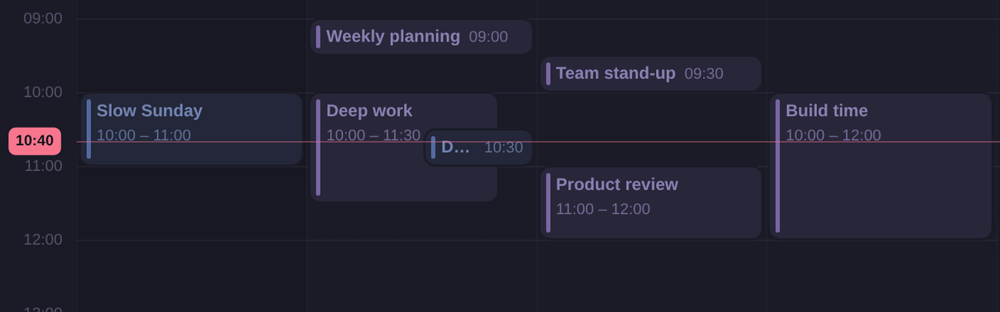

**Today** (`ui/grid.rs:287-394`, layout in `ocal-core/layout.rs:97-140`)
- Opaque `tint(color, 0.16)` fill, 2 px left border in calendar colour, hover 0.26 (`:313-320`).
- Highlighted (selected or crossed by the time cursor): `tint 0.3` and a 1 px accent border (`:297-316`).
- Events under 45 min show the title only. Otherwise title, then time range; location from 1.5 h (`:294`, `:340-364`). Declined events are struck through; past and declined events are at 55% opacity (`:295-296`, `:326`).
- Overlaps get **equal-width lanes** per overlap group (`ocal-core/layout.rs:97`).
- Right-click opens a context menu (`:380-392`).

**Prototype**
- 7 px rounded blocks. The colour bar is a separate 3 px rounded strip inset 4 px from the edge. A 1.5 px ring in the background colour separates touching or overlapping blocks.
- Text is calendar colour mixed 50% with `bright`; the secondary line is at 75% opacity.
- **Short events (≤ 30 min)** use one line: title + start time ("Team stand-up 09:30").
- **Past events** use a weaker mix (9% fill, colour mixed into `muted`) rather than opacity.
- **Selected** events are solid calendar-colour fill with `on_accent` text and a coloured glow shadow, raised above neighbours.
- **Overlap layout cascades**: each column except the last spans up to 1.7× its lane width, and later columns sit on top (z-order). See "Deep work" and "Design review" on Monday.

**To implement**
- [ ] Block restyle: radius, inset colour strip, background-coloured ring, mixed text colour. — visual, S. On a light theme a 50% mix towards `bright` reads well in the prototype (`00b-overview-light.png`), but check it against real Google calendar colours, which are often pastel.
- [ ] Single-line short events with an inline start time. Threshold 30 min vs today's 45 min: **decide**, since 45 min blocks at 100% zoom are about 2.4 rem tall and can hold two lines. — visual, S.
- [ ] Past events via colour mix instead of opacity. — visual, S.
- [ ] Selected style: solid fill, `on_accent` text, glow, raised z-order. The time-cursor highlight needs its own (weaker) style so the two stay distinct. — visual, S.
- [ ] Cascading overlap widths: add a `span` to `Placement` (or compute it in the app) and draw columns in order. — core, M (update `lanes` tests in `ocal-core/layout.rs`). **Decide**: cascades hide the right part of earlier events' titles.

## 6. Day view

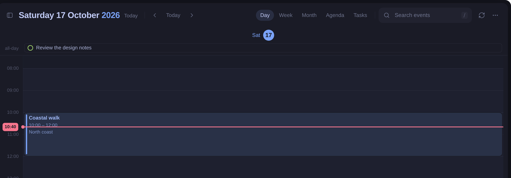

**Today**: the same grid with one column (`ui/mod.rs:642-651`); the title is "Saturday 17 October 2026" (`ui/chrome.rs:19-24`). In narrow windows, Week becomes three days.

**Prototype**: identical treatment to Week (sections 4–5) with one wide column. No week badge.

**To implement**: nothing beyond sections 4–5.

## 7. Month

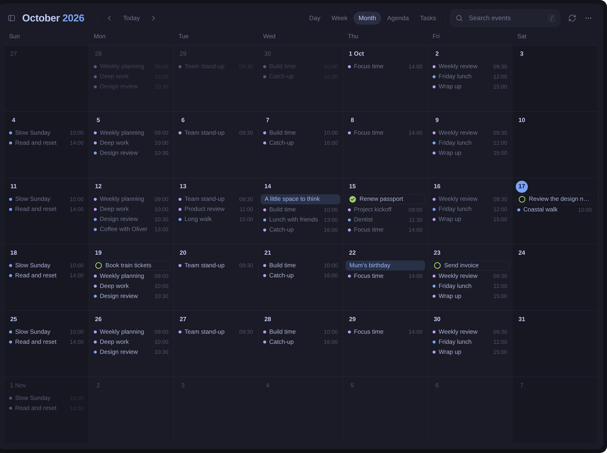

**Today** (`ui/month.rs`)
- "SUN … SAT" header (`:17-36`). Square day badge; today filled (`:86-97`). The selected date gets an accent outline on the whole cell (`:65-71`).
- Out-of-month cells use `inset` fill (`:53-59`).
- All-day items are `Bar` chips. Timed items are `Dot` chips: dot · time · title (`ui/agenda.rs:70-94`).
- **Tasks excluded** (`:110`).
- Rows fit the measured cell height, with "+N more" → Day view (`:11-16`, `:113-153`). Clicking the date number goes to Day view **only in compact windows** (`:98-105`).
- Double-click creates (`:155-163`). Right-click offers New event / New task (`:180-195`).

**Prototype**
- Circular day number; today filled; selected date as a **ring on the number**, not the cell.
- The first of each month is labelled "1 Oct" / "1 Nov".
- Out-of-month cells are not filled; the numbers are faint and the events dimmed to 40%.
- Timed rows: dot · title · **time right-aligned**. All-day and **tasks** are pills (tasks with checkboxes).
- Fixed max of 4 rows ("N more" after 3). Clicking a day number always opens Day view.

**To implement**
- [ ] Number restyle; ring for the selected date instead of the cell outline. — visual, S.
- [ ] "1 Oct" label on the first of the month. — visual, S.
- [ ] Out-of-month treatment: dim content instead of `inset` fill. — visual, S.
- [ ] Timed chip layout: title then right-aligned time. — visual, S.
- [ ] Tasks in month cells with an inline checkbox (shared with section 4). — behaviour, S once section 4 exists.
- [ ] Date number → Day view at all widths. — behaviour, S.
- [ ] Keep measured-fit row counts. — **keep** (better than a fixed 4).

## 8. Agenda

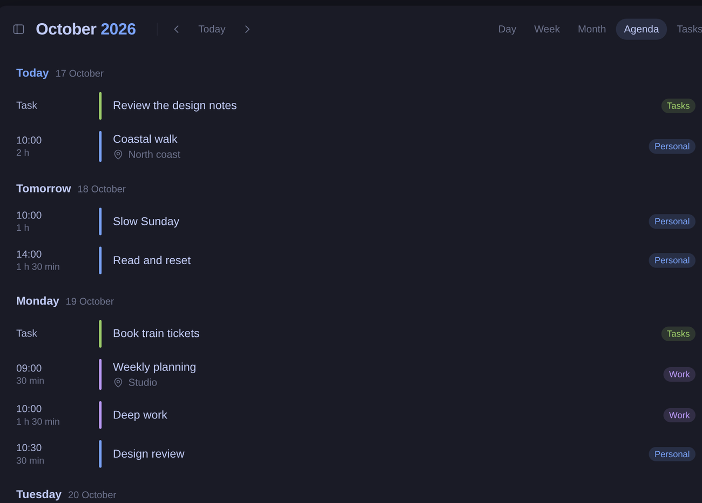

**Today** (`ui/agenda.rs:168-282`)
- 60 days forward from the selected date (`:174-181`).
- Left date column (weekday, big day number, month) per day (`:221-246`).
- `Row` chips: time range · colour bar · title / location · video icon if linked (`:95-150`).
- **Tasks excluded** (`:185`).
- The same list renders search results across −60 / +120 days, with a "N events matching" header (`:173-204`).

**Prototype**
- Day headings across the list ("**Today** 17 October", "**Monday** 19 October"). Relative names for today and tomorrow; today in accent. Headings are **sticky** while scrolling.
- Rows: start time over duration ("10:00 / 2 h"), 4 px rounded bar, title, a sub-line with a pin icon + location and a video icon + "Google Meet", and the **calendar name** right-aligned.
- Tasks ("Task") and all-day items ("All day") included.
- 21 days; rounded hover and selection.

**To implement**
- [ ] Heading-row layout instead of the date column, with relative day names. — visual, S (`relative_day` exists, `ui/sidebar.rs:372-380`).
- [ ] Sticky day headings. — behaviour, M. GPUI has no `position: sticky`; draw an overlay heading from the scroll offset and measured group bounds.
- [ ] Time + duration column; pin and video icons in the sub-line; calendar name tag. — visual, S.
- [ ] Meeting provider label from the link host (Meet / Zoom / Teams / generic "Meeting"). — behaviour, S.
- [ ] Include tasks and all-day items. — behaviour, S.
- [ ] Keep the 60-day range. — **keep**.

## 9. Tasks view

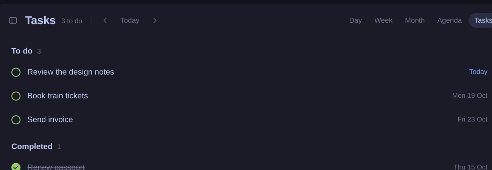

**Today** (`ui/agenda.rs:283-398`)
- "TO DO" and "COMPLETED" section labels (`:297-302`).
- Square checkbox icons (`Square` / `SquareCheck`) as tool buttons in accent (`:322-347`).
- Title struck through when done; relative due date, **danger** when overdue (`:305`, `:373`); calendar swatch.

**Prototype**
- "**To do** 3" and "**Completed** 1" headings with counts.
- **Round checkboxes** in the calendar colour, filled with a tick when done.
- Due date right-aligned: "Today" in accent, otherwise "Mon 19 Oct". No swatch.
- Rounded hover rows.

**To implement**
- [ ] Headings with counts. — visual, S.
- [ ] Round calendar-coloured checkbox component, reused in sections 4, 7 and 8. — visual, S (custom; gpui-omarchy's `checkbox` is square).
- [ ] Due-date formatting, "Today" in accent. — visual, S.
- [ ] Keep overdue in `danger`. — **keep** (the prototype has no overdue case).

## 10. Event details popover

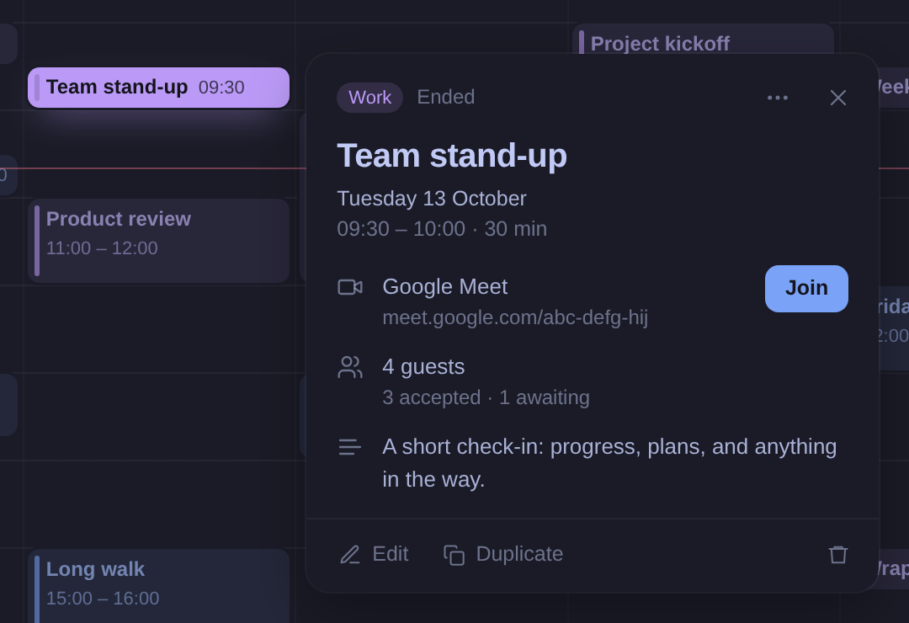
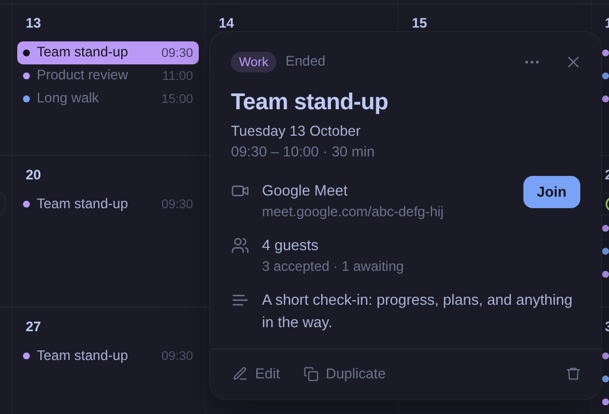

**Today** (`ui/details.rs:30-467`)
- A **docked panel** under the header on the right edge, 24 rem wide (full width when compact) (`:403-427`).
- Header: colour bar, calendar name, "…" actions menu, close (`:428-458`).
- Body: title; date, time and **relative time** ("in 25 min", "Now · 40 min left", "Ended") (`:81-103`); a time-zone line when the event's zone differs (`:125-139`); repeat line (`:140-150`).
- Location with copy (`:151-169`); **Join meeting** + copy link (`:170-207`); Meet pending and failure states (`:208-220`).
- **Per-guest list** with response icons and "N of M going" (`:221-257`); **RSVP** Yes / Maybe / No (`:258-320`); notes (`:321-331`).
- Footer: Edit (primary), Duplicate, Delete with an inline **confirmation** (`:336-402`).

**Prototype**
- A floating card **anchored beside the clicked event**, styled like Omail's reply box: `background` fill, 14 px radius, hairline ring and shadow. It sits right of the event, flips left when there is no room, and is clamped to the window. Clicking the same event again closes it; clicking outside closes it.
- Header: calendar name as a coloured **chip** (Omail's label chip), "Ended" for past events, "…", close.
- 20 px title. Date, then "09:30 – 10:00 · **30 min**".
- Icon rows: **Google Meet** with the link underneath and a compact accent **Join** button on the right; location; guests summary ("4 guests", "3 accepted · 1 awaiting"); notes.
- Footer: quiet Edit and Duplicate buttons (Omail's reply modes) and a trash icon that turns red on hover. Tooltips hint **Enter** to edit and **Del** to delete. **Delete is immediate** and shows a toast with **Undo**; there is no confirmation.

**To implement**
- [ ] Anchored popover: record each rendered event's bounds (as `grid_bounds` does via `on_prepaint`, `ui/grid.rs:218-222`) and position the card with GPUI `anchored()` or absolute placement. Flip, clamp, and follow scrolling or close on scroll. Anchor to the right sidebar item when opened from Up next or the Now card. — behaviour, L.
- [ ] Toggle closed when clicking the selected event again. Clicks on empty grid or month space already clear the selection (`ui/grid.rs:497`, `ui/mod.rs:634`); extend that to the sidebar and toolbar. — behaviour, S.
- [ ] Card styling: radius, ring and floating shadow, calendar chip in the header. — visual, S.
- [ ] Duration after the time range; "Ended" in the header. — visual, S.
- [ ] Meeting row: provider name, link and a compact Join button. — behaviour, S.
- [ ] Enter on an open details card edits the event; Delete deletes it. — behaviour, S (new actions + bindings in `ui/mod.rs:70-101`; today Enter opens the highlighted event).
- [ ] Guests summary line. **Decide**: keep the per-guest list (expand on click) and RSVP; the prototype only shows a count.
- [ ] Delete with an **Undo** toast instead of a confirmation. — core, M/L. Local events can be restored from a kept copy; a deleted Google event needs re-creating (new ID) or deferring the remote delete until the toast expires. **Decide**, or keep the confirmation.
- [ ] Keep relative time, the time-zone and repeat lines, copy buttons, Meet pending/failure and RSVP. — **keep**.
- [ ] Narrow windows: an anchored card cannot fit at 480 px; fall back to today's full-width panel. — behaviour, S.

## 11. New-event composer

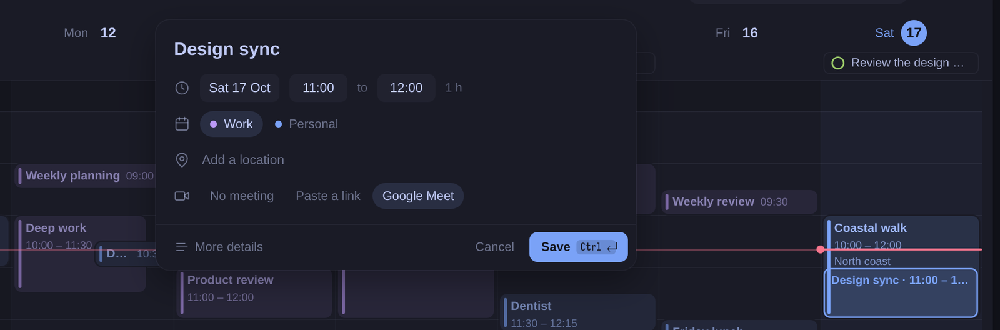

**Today** (`ui/editor.rs:561-1062`)
- A **docked panel** on the right, 26 rem wide, between header and status bar (`:1011-1033`).
- Title input (`:781-792`); calendar `select` with swatch, labelled with the account (`:737-754`); **All day** switch (`:755-768`).
- Starts / Ends rows, each a `date_picker` + typed time that steps by 15 min with arrow keys (`:640-691`); loose time parsing (`:129-165`); the end moves with the start (`:351-371`); duration label (`:692-696`).
- Location; Meeting segmented None / Link / Google Meet with a link field and a Meet note (`:697-736`, `:815-832`); Guests + Email guests switch for Google calendars (`:833-856`).
- **More details**: Repeat, Time zone, Notes (`:873-931`).
- Footer: keycaps "ctrl ↵ save / esc close" and Save / "Save & invite" (`:987-1010`). Discard-changes check (`:957-986`); inline error (`:945-956`).
- Draft preview drawn in the grid (`ui/grid.rs:422-463`).

**Prototype**
- A **floating card** (480 px) centred over the sheet near the top, styled like Omail's reply box, with an accent focus ring while typing.
- Large borderless title ("New event" placeholder).
- One **When** row: date chip, start chip "to" end chip, duration.
- Calendar picker as **pill tabs with colour dots**; location row with a pin icon; Meeting pill tabs (No meeting / Paste a link / Google Meet).
- Footer: quiet **More details** (Omail's reply mode button), Cancel, primary **Save** with a `Ctrl ↵` keycap. Save is dimmed until the title has text, like Omail's Send. Saving shows a "Saved to Work" toast and opens the new event's popover.
- A ghost block in the grid shows "Design sync · 11:00 – 12:00" with an accent outline.
- Opening the composer from Month or Agenda **switches to Week**. A new event defaults to the next half hour (from "now" or the double-clicked slot, snapped to 30 min).

**To implement**
- [ ] Floating card container (centred, radius, shadow) replacing the docked panel at normal widths; keep the docked or full-width panel for narrow windows. — visual + behaviour, M.
- [ ] Compact When row: a date chip that opens the existing `date_picker` calendar in a popover, start and end time chips reusing the typed and stepped time inputs, duration label. — behaviour, M. Multi-day timed events need an end-date chip, shown when the end date differs or on demand.
- [ ] Calendar pill tabs. — visual, S. **Decide**: tabs don't scale past 3–4 calendars or to account-labelled names (`ocal-core/model.rs` `display_name`). Show tabs for the few most-used calendars and keep the `select` for the rest.
- [ ] Meeting pill tabs (restyle of the existing segmented control). The prototype shows no link field after choosing "Paste a link"; keep the field. — visual, S.
- [ ] Footer: quiet More details on the left, Cancel + Save with keycap; Save dimmed until there is a title. — visual, S.
- [ ] Ghost preview text "Title · 11:00 – 12:00" and an accent outline instead of a calendar-colour fill. — visual, S.
- [ ] Toast on save ("Saved to Work") and open the saved event's popover (the app already selects it: `ui/mod.rs:413-428`). — behaviour, S once toasts exist.
- [ ] Keep All day, the end date, Guests + notify, Repeat, Time zone, Notes (behind More details), the discard check and inline errors. — **keep** (the prototype's More details does nothing).
- [ ] **Decide**: don't switch to Week when creating from Month (the app creates all-day there, `ui/mod.rs:721-723`) or from Agenda.

## 12. Feedback: toasts, shortcuts popover, tooltips

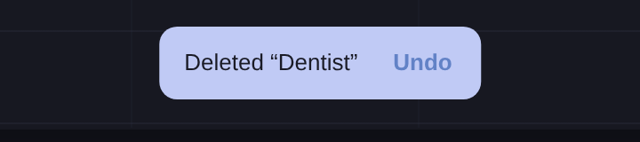
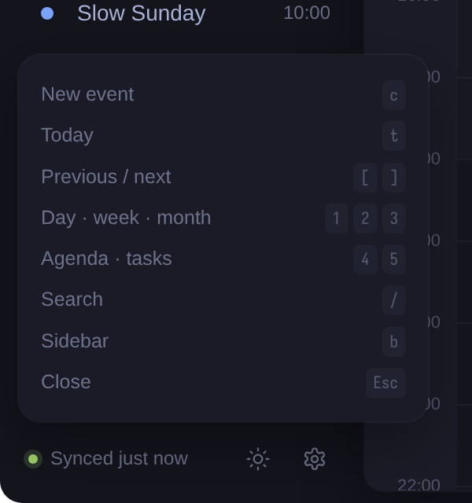

**Today**
- All feedback is a line of text in the status bar (`ui/chrome.rs:372-381`): "Saved", "Event deleted", "Location copied", errors in `danger` (`ui/mod.rs:393-445`, `ui/details.rs:75`).
- Keyboard help is a full page with four groups (`ui/settings.rs:478-559`).
- Tool buttons have tooltips with shortcuts, "New event · C" (`appearance.rs:4-31`).

**Prototype**
- **Toast**: Omail's inverted bar (`bright` fill, `background` text, 10 px radius) at the bottom centre. It stays 4 s and can carry an action: "Deleted “Dentist” · **Undo**". It also confirms saves ("Saved to Work"), task completion and manual sync.
- **Shortcuts card**: a small floating card above the sidebar footer with 8 rows (New event, Today, Previous / next, views, Search, Sidebar, Close). Toggled with `?`; closed by Esc or an outside click.
- **Tooltips**: Omail's bright inverted label under the control, "Label · key".

**To implement**
- [ ] Toast layer using gpui-base `ToastManager` with the `gpui_omarchy::toast` surface (`gpui-omarchy/surface.rs:282-298`), restyled to Omail's inverted bar, with an optional action button. — behaviour, M. Errors should not auto-dismiss (or should also stay in the editor and footer); sign-in progress messages need a persistent home.
- [ ] Shortcuts card on `?`, with an "All shortcuts" link to the existing help page. — behaviour, S.
- [ ] Keep the full help page (it documents arrows, Shift, Enter, Menu and zoom). — **keep**.

## 13. Search

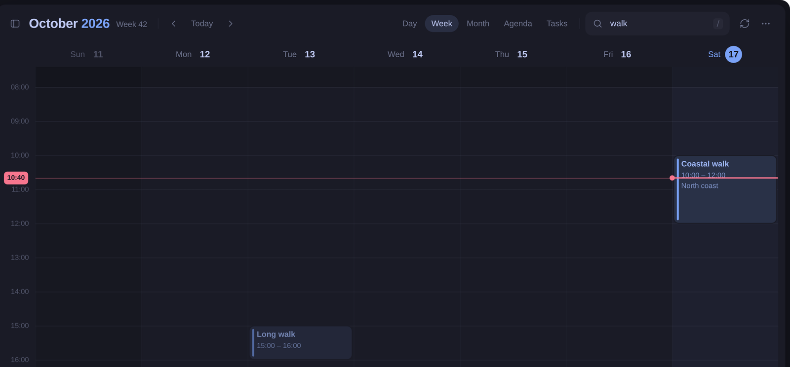

**Today**: matches title, location **and notes** (`ui/mod.rs:584-596`). A non-empty query replaces the view with agenda-style results across −60 / +120 days (`ui/mod.rs:858-859`, `ui/agenda.rs:173-204`).

**Prototype**: matches **title and location** (not notes) and **filters the current view in place** (week, month, the sidebar's Up next and the Now card), with no result count or range. The field is always visible.

**To implement**
- [ ] **Decide** the search model. Filtering in place hides matches outside the visible period, which suits a quick filter but not "find that event". Suggestion: filter in place while typing, and keep the results list on Enter, or when nothing matches in view.
- [ ] Don't filter the Now card or Up next by the query. — behaviour, S.

## 14. Keyboard

**Today** (`ui/mod.rs:70-101`, `:957-1014`): C / Ctrl+N, T, [ ], 1–5, / and Ctrl+F, Esc, ?, Ctrl+R, B, Menu / Shift+F10, Ctrl+Enter, Ctrl+= / − / 0, Enter. Arrows move a 15-minute time cursor (`ui/grid.rs:248-286`); Shift extends a range (`ocal-core/selection.rs`); Enter opens or creates.

**Prototype**: 1–5, [ ], t, c, b, ?, /, Esc (closes composer → details → shortcuts card → clears the query, in that order), Ctrl+Enter to save, and Delete / Backspace to delete the selected event (with Undo). Enter to edit appears only in a tooltip. No arrows, Shift, Ctrl+R (tooltip only), Menu or zoom. Keys are written in lower case on keycaps and tooltips, as in Omail.

**To implement**
- [ ] Delete key for the selected event, and Enter to edit when details are open (section 10). — behaviour, S.
- [ ] **Decide** keycap case: Omail shows `c`, the app's README and tooltips show `C`. Pick one for both apps.
- [ ] Update the Esc order so a shortcuts popover or toast doesn't swallow it before details or the composer. — behaviour, S.
- [ ] Keep every existing binding. — **keep**.

## 15. Theming, light mode and density

**Today**: colours come from the live Omarchy theme, light and dark (`gpui-omarchy/system_theme.rs`). Light-theme text is handled (`appearance.rs:90-96`). Zoom runs 70–180% (`ui/mod.rs:921-938`), and tests cover 480×480 light at 180% (`ui/tests.rs:933`).

**Prototype**: Omail's two palettes, Tokyo Night and Flexoki Light, with a manual toggle in the sidebar footer (`?light=1`). Greys, fills and hairlines are `foreground` at fixed opacities, so they follow either theme. Calendar colours come from the palette (`violet`, `accent`, `success`). The remaining fixed values are shadow colours and the weekend/off-hours shade (black at 13% dark, ink at 2.5% light). There is no zoom and no narrow layout (fixed 1440×900).

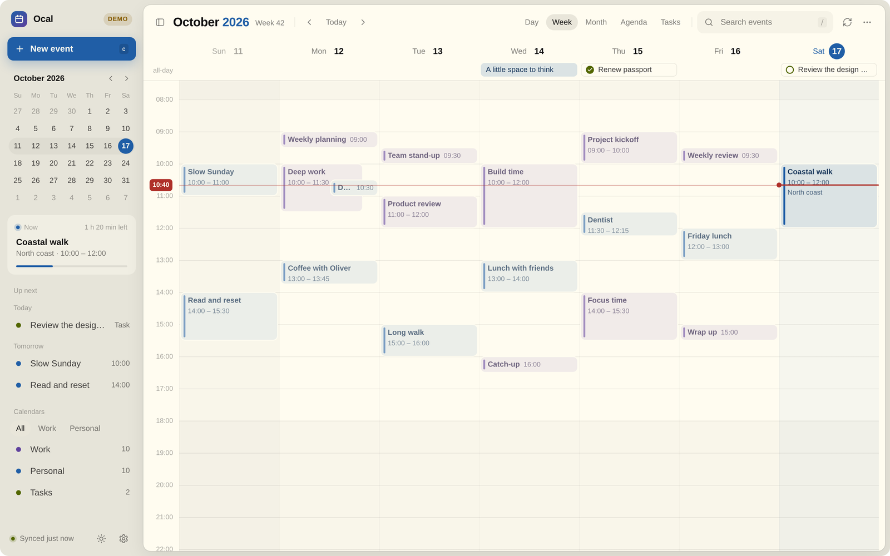

**To implement**
- [ ] Derived greys and fills (`muted`, `faint`, `hair`, `hover`, `shade`) as helpers on top of `gpui_omarchy::Theme`, ideally shared with Omail. — visual, S.
- [ ] Use each calendar's own colour (Google supplies one); the palette colours in the prototype stand in for the demo calendars. — n/a.
- [ ] **Decide** the light/dark toggle. The app follows the Omarchy system theme today; a manual toggle overrides that. Omail's prototype has the same toggle, so decide for both.
- [ ] Check the result on `Theme::flexoki_light()` and at least one other dark theme. — visual, S.
- [ ] Verify radii and padding at 70% and 180% zoom; use rems, not px, for radii that should scale. — visual, S.

## 16. Demo data

**Today**: `ocal-core/demo.rs` seeds one week of 19 events, one all-day event, **one** task and two sets.

**Prototype**: the same weekly pattern over five weeks (recurring rows plus one-offs), two all-day events ("Mum’s birthday" added), four tasks including one completed.

**To implement**
- [ ] Extend the demo to several weeks with more tasks (including a done one) and a second all-day event, so the Now card, Up next and tasks-in-grid are visible in `ocal --demo` and in tests. — core, S.

---

## What the prototype drops that the app has today

| App feature | Where today | Recommendation |
| --- | --- | --- |
| Status bar: status text, errors, selection label, key hints | `ui/chrome.rs:345-402` | **Move**: messages to toasts and the sidebar footer, errors to toasts that stay. **Decide** whether the selection label and hints survive as a slim footer in the sheet, shown only while a range is active. |
| Time cursor, arrow navigation, Shift range, Enter to open or create | `ui/grid.rs:248-286`, `ui/mod.rs:972-1014`, `ocal-core/selection.rs` | **Keep**. Restyle the cursor to match (rounded dot, accent), and keep it distinct from the red now line. |
| Shift-drag to create a range | `ui/grid.rs:489-513`, `:608-636` | **Keep**. |
| Double-click snaps to 15 min (the prototype uses 30) | `ui/grid.rs:505`, `ocal-core/selection.rs:12` | **Keep** 15 min. |
| Right-click context menus (event, slot, month cell), Menu / Shift+F10 | `ui/grid.rs:380-392`, `:532-574`, `ui/month.rs:180-195`, `ui/agenda.rs:152-165` | **Keep**; restyle the menus to match the floating cards. |
| "New task" from context menus | `ui/grid.rs:536`, `ui/month.rs:185` | **Keep**; the prototype has no way to create a task. |
| Delete confirmation | `ui/details.rs:336-364` | **Decide**: the prototype deletes at once with an Undo toast (needs core support, section 10). |
| RSVP and per-guest list | `ui/details.rs:221-320` | **Keep** (behind the guests summary). |
| Relative time, event time-zone line, repeat line, copy buttons, Meet pending/failure | `ui/details.rs:92-220` | **Keep**. |
| Editor: all day, end date, guests + notify, repeat, time zone, notes, discard check, inline errors | `ui/editor.rs` | **Keep** (under More details where sensible). |
| Account groups, read-only label, "Add Google account" | `ui/sidebar.rs:157-233` | **Keep**. |
| Mini calendar busy dots | `ui/sidebar.rs:13-20`, `:63-72` | **Decide**: dropped on purpose in the prototype to reduce clutter (section 3a). |
| Footer help button | `ui/sidebar.rs:330-366` | **Move**: `?` and the "…" menu. |
| Selected-date underline in week headings | `ui/grid.rs:68-76` | **Decide**: it shows where C/Enter will act in week view; the prototype has no equivalent. |
| "+N more" in the all-day row | `ui/grid.rs:115-136` | **Keep** with a higher cap. |
| Search over location and notes, wide range, result count | `ui/mod.rs:584-596`, `ui/agenda.rs:173-204` | **Keep** (see section 13). |
| Narrow and compact layouts: overlay sidebar, three-day week, view menu, collapsing search | `ui/mod.rs:140-178`, `:642-651`, `:1018-1029`, `ui/chrome.rs:166-179`, `:224-253` | **Keep**; design narrow variants of the sheet, popover and composer. |
| Zoom and display time zone | `ui/mod.rs:921-938`, `ui/settings.rs:387-448` | **Keep**. |
| Settings page, Import / Export, full keyboard page | `ui/settings.rs`, `ui/chrome.rs:296-343` | **Keep**; the prototype's "…" and settings buttons are placeholders. |

## Suggested implementation order

Each step is roughly one commit and leaves the app working.

1. **Style foundations**: radius, shadow and fill constants, `mix()`, muted and faint colours, pill tabs, a round checkbox component and a rounded pill. Includes a light-theme check. (S)
2. **Shell**: the rounded sheet, brand and New event moved into the sidebar, toolbar restyle (sidebar toggle, Today pill, pill view tabs, search field with keycap, week label, inverted tooltips). Keep the status bar for now. (M)
3. **Toasts and footer status**: `ToastManager` layer, structured sync state in the footer, status messages moved over; slim or remove the status bar per the decision above. (M)
4. **Grid visuals**: event blocks, selected style, short and past events, now indicator, off-hours, hour lines, headings, all-day row. Update the bounds tests in `ui/tests.rs:432`. (M)
5. **Tasks everywhere**: tasks in the all-day row, month, agenda and Up next with inline completion. (M)
6. **Sidebar content**: mini calendar restyle, Now card, Up next grouping, set tabs and set-filtered list, round calendar dots, DEMO badge. (M)
7. **Details popover**: anchored card with flip and clamp, toggle on re-click, Enter to edit and Delete, meeting row with Join, guests summary; docked fallback for narrow windows. (L)
8. **Composer card**: floating card, compact When row with date-chip popover, calendar tabs with select fallback, footer, ghost preview and save toast. Keep the full fields under More details. (L)
9. **Month, agenda and tasks**: month restyle, agenda headings (then sticky), meeting provider labels, tasks view restyle. (M)
10. **Polish**: shortcuts popover, overlap cascade (core), optional animations (card rise, Now pulse), demo data, new captures for `docs/`, and README and `docs/features.md` updates. (M)

## Things to settle before building

- **Rounded corners and shadows on Omarchy.** gpui-omarchy is square and flat on purpose. This prototype follows Omail's, which rounds and lifts surfaces, so the call is shared: if both apps go this way, the radius, shadow and grey helpers belong in a shared place rather than in each app.
- **Light/dark toggle** vs following the system theme (both apps).
- **Mini calendar busy dots** and **keycap case** (`c` vs `C`).
- **Red now line** vs the accent colour.
- **Search model** (filter in place vs results list).
- **Status bar**: remove it entirely, or keep a slim contextual footer.
- **Delete**: keep the confirmation or switch to undo.
- **Calendar tabs** in the composer and **set tabs** in the sidebar don't scale; agree on a fallback.
